<h1 align="center">Transformer From Scratch</h1>

<p align="center">
  <em>A reverse-mode automatic differentiation engine and a decoder-only transformer language model, built from scratch, with every gradient verified against finite differences.</em>
</p>

<p align="center">
  <a href="https://github.com/adeoluo/transformer-from-scratch/actions/workflows/ci.yml"></a>
  <a href="https://github.com/adeoluo/transformer-from-scratch/releases"></a>
  
  <a href="LICENSE"></a>
</p>

---

## Motivation

A transformer is usually a few lines on top of a framework that hides the two things worth
understanding: how gradients flow backward through attention, and how attention lets a model
use information from far away in the sequence. This project removes the framework. It builds a
small **reverse-mode automatic differentiation engine** over plain lists of floats, writes out
every backward pass by hand, and composes a **decoder-only transformer** entirely from those
operations, with no automatic differentiation library.

Correctness is not asserted, it is checked: every operation's analytic gradient is compared to
a finite-difference estimate, and the whole network agrees to within `1e-4`. The model is then
trained on a copy task that a fixed-order n-gram model provably cannot solve, which isolates
exactly what attention buys.

## Architecture

<p align="center">
  
</p>

<sub>Legend: amber = entry points and external systems, indigo = core logic, green = data and state, blue = validation and control, grey = observability and outputs.</sub>

The engine records a local backward closure for each operation and runs them in reverse
topological order, which is reverse-mode autodiff. The model stacks pre-norm blocks of
multi-head causal self-attention and a GELU feed-forward network, with weight-tied input and
output embeddings. Training uses an Adam optimizer written from scratch, on the synthetic copy
task or at the character level on a bundled real-text excerpt, and models save to and load
from JSON checkpoints. Evaluation reports copy accuracy and perplexity against a bigram
baseline and bits per character against a unigram baseline; the research study ablates heads
and compares depth and attention variants; and an optional test checks the logits against
PyTorch. The HTTP service validates requests, serves generation, evaluation, and attention
inspection, and records per-route metrics. See the [ADRs](docs/adr/) for the key decisions.

### The autodiff engine

Everything is built from one `Tensor` type and a minimal set of differentiable operations:
matrix multiply, biased affine maps, residual addition, scaling, GELU, row-wise **causal
softmax**, row-wise **layer normalization**, embedding lookup, column concatenation, and a
softmax **cross-entropy** loss. A single `loss.backward()` differentiates the entire network.

> **Gradients verified.** For every parameter type (embeddings, attention, feed-forward, layer
> norm) the analytic gradient matches a central finite-difference estimate to better than
> `1e-4`; the worst observed difference is around `1e-10`.

### The task: copying needs attention

A sequence is a random string, a separator, then the same string again. Predicting the second
copy requires looking back to the matching position in the first copy. An n-gram model cannot
do this because the token to emit depends on one many positions earlier, not on local context.

## Results

> Reproduce with `python -m transformer_from_scratch train`. Default model: `d_model` 24,
> 3 heads, 2 layers; trained 300 steps on CPU in under a minute. Held-out split is disjoint
> from training.

| Metric | Transformer | Bigram baseline |
|---|---:|---:|
| **held-out copy accuracy** | **0.903** | 0.234 |
| overall next-token accuracy | 0.623 | 0.209 |
| perplexity | 2.285 | - |

The from-scratch transformer reaches **0.903 copy accuracy versus 0.234** for a bigram model
estimated on the same data, a near-4x gap that exists entirely because attention can copy and
an n-gram model cannot. Overall accuracy is capped because the first half of each sequence is
random and unpredictable by construction.

### Attention becomes confident as it learns

| Attention statistic (sharpest head) | Untrained | Trained |
|---|---:|---:|
| mean peak weight over the copy region | 0.425 | **0.981** |
| mean attention entropy | 1.84 | **0.00** |

At initialization a head spreads its weight almost uniformly (high entropy); after training the
sharpest head places essentially all of its weight on a few source positions (entropy collapses
to zero). This is a direct, honest readout that the model learned structured, content-dependent
attention rather than memorizing local statistics.

### Training on real text, not just the synthetic task

The copy task isolates what attention buys, but the same model also learns real natural language.
`benchmarks/text_training.py` trains the transformer at the **character level** on a bundled
public-domain prose excerpt (the opening of Jane Austen's *Pride and Prejudice*, 1813) and measures
held-out compression in **bits per character** against a unigram baseline.

> Reproduce with `uv run python benchmarks/text_training.py`. Corpus: 1,718 characters, 44 distinct
> symbols; `d_model` 32, 2 layers, context 24; held-out suffix disjoint from the training prefix.

| Metric | Value |
|---|---:|
| **held-out compression** | **3.639 bits/char** |
| unigram baseline | 4.303 bits/char |
| improvement over baseline | **0.663 bits/char** |
| final training loss (from 4.072) | 1.561 |

The model compresses held-out text to **3.639 bits per character, 0.663 bits better than a unigram
model** fit on the same data, so it has learned real conditional structure in English rather than
only a synthetic pattern. A sampled continuation from the prompt `"It is "` produces word-like
fragments with plausible letter statistics. The model is deliberately tiny and trained on CPU in a
few minutes, so this measures that the architecture and optimizer learn language, not a
state-of-the-art language model.

### Independent validation: PyTorch numerical parity

The hand-written autodiff is validated two ways. `tests/test_autograd.py` checks analytic gradients
against finite differences; `tests/test_torch_parity.py` reconstructs the exact forward pass in
**PyTorch**, loads the same weights, and asserts the logits and cross-entropy match to **better than
1e-9**. PyTorch is an opt-in `validation` dependency group, not a runtime dependency, and default CI does
not require it. Run the parity check with:

```bash
uv sync --group validation && uv run pytest tests/test_torch_parity.py
```

### Checkpointing

A trained model serializes its configuration and every parameter to a JSON checkpoint and reloads
to a byte-identical model, so training can be saved and resumed and a trained model can be shipped:

```python
model.save("model.json")
restored = Transformer.load("model.json")  # restored.logits(x) == model.logits(x)
```

### Scale

`benchmarks/scale.py` trains one small model, then runs the from-scratch forward pass
(`model.logits`) over progressively larger batches of held-out sequences and records
wall-clock time, inference throughput, peak memory (`tracemalloc`), and held-out copy
accuracy. Throughput is roughly flat near 20 sequences per second, confirming linear
scaling in the number of sequences, while copy accuracy stays stable because the same
trained model is applied at every size. Run with `uv run python benchmarks/scale.py`.

| Sequences | Seconds | Throughput (seq/sec) | Peak memory (MiB) | Copy accuracy |
|---:|---:|---:|---:|---:|
| 40 | 3.85 | 10.4 | 9.99 | 0.855 |
| 80 | 3.60 | 22.2 | 12.22 | 0.843 |
| 160 | 7.87 | 20.3 | 17.80 | 0.856 |
| 320 | 15.99 | 20.0 | 16.88 | 0.859 |

Honest caveat: the data is synthetic, the model is deliberately tiny, and this Python
implementation is not benchmarked against compiled tensor libraries; the first row carries
warmup overhead, so treat it as a lower bound.

### Research study: what makes copying work?

[`docs/RESEARCH.md`](docs/RESEARCH.md) is a pre-registered causal study of *how* the model
copies and what architecture it needs. Three hypotheses and numeric decision thresholds were
committed before any run; then 5 architectures were trained for 8 seeds each at the same step
budget (40 runs), every attention head of the 2-layer models was ablated, and the critical
heads' attention patterns were probed. Reproduce with `uv run python benchmarks/research_study.py`.

| Hypothesis | Verdict | Result (mean ± std over 8 seeds) |
|---|---|---|
| H1: ablating the single sharpest head drops copying to near baseline; other heads matter little | **MIXED** | holds in 4 of 8 seeds; in others copying is split across two heads, or the sharpest head is not the important one |
| H2: a 1-layer model cannot match 2 layers at matched steps or parameters | **NOT SUPPORTED** | 1 layer 0.967 ± 0.090 (matched steps) and 0.976 ± 0.041 (matched parameters) vs 2 layers 0.976 ± 0.034 |
| H3: a uniform mean-pooling mixer fails the task | **MIXED** | 0.520 ± 0.026: far below attention, but well above the bigram baseline (0.250 ± 0.012) |

The main finding is negative: **this model does not learn an induction circuit.** Copying is
done by one or two layer-1 heads that attend to a fixed offset (`length` positions back), with
near-zero attention on look-alike positions; ablating all of layer 1 drops accuracy to
0.224 ± 0.039, while ablating all of layer 2 costs only 0.025. Fixed-length sequences with
absolute position embeddings make that positional shortcut available, which is why depth does
not help. The write-up covers threats to validity and the follow-up that would actually test
induction (randomly offset repeats).

### Evaluation method

Train and test splits are generated with seeded randomness and are disjoint by construction.
All runs are deterministic given a seed. Full method and tables:
[`docs/EVALUATION_REPORT.md`](docs/EVALUATION_REPORT.md).

## Quickstart

```bash
git clone https://github.com/adeoluo/transformer-from-scratch.git && cd transformer-from-scratch
make setup                      # install dev tooling + pre-commit hooks
make all                        # lint + type-check + test

python -m transformer_from_scratch train       # train and compare to the bigram baseline
python -m transformer_from_scratch evaluate     # held-out accuracy and perplexity
python -m transformer_from_scratch generate     # greedily complete a held-out prompt
python -m transformer_from_scratch attention    # print the sharpest head's attention pattern
python -m transformer_from_scratch serve        # start the HTTP service on :8000
```

## Usage

### Demonstration

```text
$ python -m transformer_from_scratch train
Trained 300 steps on the copy task (symbols=4, length=5).
  transformer: copy_acc=0.9031, overall_acc=0.6234, ppl=2.285
  bigram:      copy_acc=0.2344
  sharpest attention head: layer 0 head 1, peak 0.981
```

### HTTP service

A standard-library HTTP service trains once at startup, then answers generation, evaluation, and
attention-inspection requests. The routing logic is a pure function, tested without a socket.

| Method | Path | Purpose |
|---|---|---|
| GET | `/health` | liveness and model shape |
| GET | `/ready` | readiness once the model is trained |
| GET | `/metrics` | per-route request, error, and latency metrics (Prometheus text) |
| POST | `/generate` | body `{"prompt": [int], "max_new_tokens": int?}`; greedy continuation |
| GET | `/evaluate` | copy accuracy, overall accuracy, and perplexity on held-out data |
| POST | `/attention` | body `{"tokens": [int], "layer": int?, "head": int?}`; attention pattern |

```bash
curl -s localhost:8000/generate -d '{"prompt": [1,2,3,4,0], "max_new_tokens": 5}'
curl -s localhost:8000/attention -d '{"tokens": [1,2,3,4,0,1], "layer": 0, "head": 1}'
```

## Design decisions

- **A matrix-valued autodiff engine, not scalar autograd** - scalar (micrograd-style) autodiff
  is too slow for attention; dense-matrix tensors keep the code readable and tractable. See
  [ADR 0002](docs/adr/0002-matrix-autodiff.md).
- **A copy task, not natural text** - a verifiable task where an n-gram baseline provably fails
  isolates the contribution of attention and keeps every number reproducible in seconds. See
  [ADR 0003](docs/adr/0003-copy-task.md).

## Testing

```bash
make lint        # ruff format --check and ruff check
make type        # mypy src (strict)
make test        # pytest (all tests, including the slow end-to-end check)
make coverage    # pytest with an 80% coverage gate
uv sync --group validation && uv run pytest tests/test_torch_parity.py   # opt-in PyTorch parity
```

The suite in `tests/` has 54 tests:

- `test_autograd.py`: analytic gradients against central finite differences for every parameter type, gradient accumulation into the weight-tied embedding, and random restarts.
- `test_model.py`: tensor operations (matmul, causal softmax, layer norm), model shapes and configuration validation, disjoint data splits, training learning to copy above the bigram baseline, determinism, and attention sharpening with training.
- `test_text.py`: the character vocabulary, the bundled prose corpus, the unigram baseline, character-level training, bits per character, and checkpoint round trips.
- `test_research.py`: head ablation, the uniform mean-pooling mixer, parameter matching, the hypothesis verdict rules, study determinism, and an end-to-end research run (marked `slow`).
- `test_service_cli.py`: HTTP routes through the pure routing function (no socket), input validation, metrics, and the CLI.
- `test_torch_parity.py`: logits and cross-entropy against a PyTorch reference; skipped unless the `validation` group is installed.

CI (`.github/workflows/ci.yml`) runs format, lint, type check, and the coverage-gated tests with `-m "not slow"` on Python 3.11 and 3.12, then builds the package and the Docker image. CodeQL runs in `codeql.yml`.

## Responsible AI

- **Model card:** [`docs/MODEL_CARD.md`](docs/MODEL_CARD.md)
- **Data card:** [`docs/DATA_CARD.md`](docs/DATA_CARD.md)
- **Threat model:** [`docs/THREAT_MODEL.md`](docs/THREAT_MODEL.md)

## Limitations

- The model is tiny and trained on a synthetic copy task; it demonstrates mechanisms (backprop
  through attention, attention-based copying), not language modeling at scale.
- Execution in interpreted Python is slow. Greedy generation recomputes a full forward pass per token
  (no key-value cache), so the service sustains tens of requests per second, not thousands.
- The copy is not implemented by a textbook induction head: the research study shows it is a
  positional lookup by one or two layer-1 heads, which the fixed-length task allows.

## Roadmap

- [x] Train on real text and report held-out bits per character against a baseline.
- [x] Validate the forward pass against PyTorch to a tight numerical tolerance.
- [x] Add model checkpointing (save, load, resume).
- [ ] Add a key-value cache so generation is linear rather than quadratic per token.
- [ ] GPU acceleration: this engine is CPU-only and trains small models in minutes;
      a vectorized or compiled backend would be required for larger corpora and real throughput.
- [ ] Train on a larger corpus with a word or subword tokenizer and report validation perplexity.

## License

Released under the [MIT License](LICENSE).
