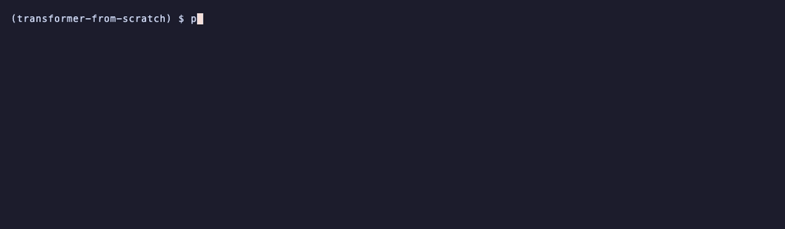
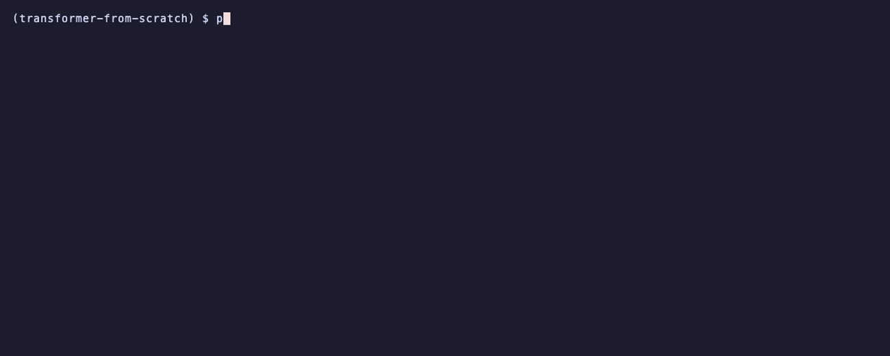

<h1 align="center">Transformer From Scratch</h1>

<p align="center">
  <em>A small transformer language model and its gradient engine, written from scratch in NumPy so every step of the math can be read and checked.</em>
</p>

<p align="center">
  <a href="https://github.com/adeoluo/transformer-from-scratch/actions/workflows/ci.yml"></a>
  <a href="https://github.com/adeoluo/transformer-from-scratch/releases"></a>
  
  <a href="LICENSE"></a>
</p>

---

> **Evidence level: reference validated.** On every change, an automated test compares a test model with PyTorch (a widely used deep learning library). The outputs, the loss and all 48 parameter gradients agree to within 1e-9 (0.000000001). The model has been trained only on small practice tasks. Nobody else has reproduced the results, and the model is not used in production.

## Highlights

A transformer is the type of neural network inside chatbots such as ChatGPT. This project builds
a small one using only NumPy (the main Python library for array math). The gradient math, which
tells the model how to adjust its weights during training, is written out by hand.

- **The hand-written gradient math matches PyTorch.** For a test model, all 48 sets of
  gradients agree with PyTorch to within 0.000000001. An automated test checks this on every
  change.
- **The model learns to copy.** On held-out copy sequences, it predicts 87.2% of the copied
  symbols correctly, compared with 23.4% for a bigram baseline. This is one run with seed 0 on
  macOS ARM64, and the same run on Linux typically scores between about 71% and 90%.
- **It also learns from real English text.** On unseen text from *Pride and Prejudice*, it needs
  3.639 bits per character, where lower is better. A baseline that only counts letter
  frequencies needs 4.303.
- **A pre-registered study shows how it copies.** The model looks a fixed number of positions
  back instead of using an induction head. Averaged over 8 seeds, switching off its first layer
  drops copy accuracy to 0.224, while switching off the second layer costs only 0.025.

**Where it falls short:** it is a small model trained on small practice tasks. Its copy task can
be solved with a position-based shortcut. It is meant for reading and learning, not for real
workloads.

## Key terms

Plain definitions of the terms used in this README.

| Term | Meaning |
|---|---|
| Ablation | Switching off one part of a trained model, here by setting an attention head's output to zero, then measuring the accuracy drop. A larger drop means the part mattered more. |
| Attention | The step where each position in a sequence takes a weighted mix of information from earlier positions. The weights decide which earlier tokens it "looks at". |
| Attention entropy | How spread out a head's attention weights are, in natural-log units. It is 0 when all weight is on one position, and lower means sharper focus. |
| Attention head | One of several attention units that run side by side in a layer, each learning its own pattern. The default model has 3 heads in each of 2 layers. |
| Automatic differentiation (autodiff) | Code that computes gradients automatically. The reverse-mode version used here records each operation, then applies their gradient rules backward from the loss. |
| Bigram model | A baseline that predicts the next token only from the current token, using counts from the training data. It cannot copy a symbol seen several positions earlier. |
| Bits per character | The average number of bits a model needs to encode each character of unseen text. Lower is better. |
| Copy accuracy | The share of symbols in the second copy that a model predicts correctly on held-out sequences. From 0 to 1, higher is better. |
| Copy task | The synthetic test task: 5 random symbols from an alphabet of 4, a separator, then the same 5 symbols again. |
| Finite-difference check | A numerical test of a gradient. A weight is moved slightly up and down, and the change in the loss is compared with the hand-written gradient. |
| Gradient | For each weight, how much the loss would change if that weight changed slightly. Training uses gradients to adjust the weights so the loss goes down. |
| Held-out set | Test sequences kept apart from training, so results measure generalization rather than memorization. Here they share no sequence with the training data. |
| Induction head | A known two-layer attention pattern in language models: find an earlier copy of the current token, then predict the token that followed it. |
| Language model | A model that predicts the next token (a symbol, character or word) from the tokens before it. |
| Mean ± standard deviation | The average result over several runs (here 8 seeds), and how far single runs typically spread around that average. |
| n-gram model | A model that predicts the next token only from the previous n - 1 tokens. A bigram model is the case n = 2. |
| Next-token accuracy | The share of all positions in held-out sequences where the model's top prediction is correct. From 0 to 1, higher is better. |
| Peak attention weight | The largest weight a head gives to any single position, averaged over the copy positions. From 0 to 1, near 1 means it looks at one position. |
| Perplexity | How uncertain the model is about the next token: roughly the number of equally likely choices it is guessing among. 1 is perfect, lower is better. |
| Pre-registered study | A study whose hypotheses and pass or fail rules are committed before any experiment runs, so the rules cannot be adjusted after seeing the results. |
| PyTorch | A widely used open-source deep learning library. Here it serves only as an independent reference to check the hand-written math. |
| Seed | A number that fixes all random choices in a run (data, starting weights, batch order). The same seed gives the same run on the same platform. |
| Transformer | A neural network built from attention and feed-forward layers. "Decoder-only" means each position can use only itself and earlier positions, as in GPT-style text generators. |
| Uniform mean-pooling mixer | A control that replaces attention: each position takes a plain average of all positions up to itself, with no choice of where to look. |
| Unigram model | A baseline that predicts each character only from how often it appears in the training text, ignoring the characters before it. |

## Motivation

In most code, a transformer is a few lines on top of a deep learning framework. The framework
hides the two parts most worth understanding. The first is how gradients flow backward through
attention. The second is how attention lets a model use information from far back in the
sequence.

This project removes the framework. It builds a small **reverse-mode automatic differentiation
engine** that works on NumPy arrays. It writes out every backward pass (the gradient rule of an
operation) by hand. It then builds a **decoder-only transformer** entirely from those
operations, with no automatic differentiation library.

Correctness is checked, not assumed. A test compares the hand-written gradients of 11
parameters, covering every kind of layer, with finite-difference estimates taken through the
whole network. They agree to within `1e-4` (0.0001). The model is then trained on a copy task that a
bigram model cannot solve. No n-gram model whose context is shorter than the distance back to
the copied symbol can solve it either. This shows what attention adds.

## Architecture

<p align="center">
  
</p>

<sub>Legend: amber = entry points and external systems, indigo = core logic, green = data and state, blue = validation and control, grey = observability and outputs.</sub>

For each operation, the engine records a small function that computes its backward step. It
then runs these functions in reverse topological order, from the loss back to the inputs. This
is reverse-mode autodiff. The model stacks pre-norm blocks, which apply layer normalization
(rescaling each row to a fixed mean and spread) before each sub-layer. Each block has multi-head
causal self-attention, where each position attends only to itself and earlier positions. Each
block also has a feed-forward network with the Gaussian Error Linear Unit (GELU) activation, a
smooth nonlinear function. The input and output embeddings (the learned vector for each token)
share the same weights, which is called weight tying.

Training uses the Adam optimizer (a standard method for updating weights from gradients), also
written from scratch. It trains on the synthetic copy task, or at the character level on a
bundled excerpt of real text. Models save to and load from JSON checkpoint files. Evaluation
reports copy accuracy and perplexity compared with a bigram baseline, and bits per character
compared with a unigram baseline. The research study switches off heads one at a time and
compares different depths and attention variants. CI (continuous integration, the automated
checks that run on GitHub) compares the model with PyTorch. It checks the forward logits (the
raw output scores), the loss and all 48 parameter gradients. The [ADRs](docs/adr/)
(architecture decision records) explain the key decisions.

### The autodiff engine

Everything is built from one `Tensor` type and a small set of operations that can be
differentiated. These are matrix multiply, affine maps with a bias, residual addition, scaling
and GELU. They also include row-wise **causal softmax**, row-wise **layer normalization**,
embedding lookup, column concatenation, and a softmax **cross-entropy** loss. An affine map is a matrix multiply plus a
constant bias vector. Residual addition adds a sub-layer's input back to its output. Embedding
lookup fetches the learned vector of each token, and column concatenation joins matrices side by
side. Causal softmax turns scores into weights
that sum to 1 while ignoring future positions. Cross-entropy is the standard training loss for
next-token prediction, and lower is better. A single call to `loss.backward()` computes
gradients for the whole network.

The forward and backward pass of each operation is written by hand and runs as NumPy array
arithmetic. The first version of the engine did the same arithmetic with Python lists. The NumPy
version reproduces its gradients to within 6e-16 (0.0000000000000006) and trains 14 to 24 times faster.

> **Gradients verified.** The test covers 11 parameters from every kind of layer (embeddings,
> attention, feed-forward, layer norm). For each one, the hand-written gradient matches a
> central finite-difference estimate to within `1e-4`. The largest difference observed is about
> `1e-10` (0.0000000001).

### The task: copying needs attention

Each sequence is a random string, a separator, then the same string again. To predict a symbol
in the second copy, the model must look back to the matching position in the first copy. A
bigram model cannot do this, and neither can any n-gram model whose context is shorter than that
distance. The symbol to output depends on a token many positions earlier, not on the tokens just
before it.

## Results

> Reproduce with `python -m transformer_from_scratch train`. Default model: `d_model` 24 (the
> length of each token's vector), 3 heads, 2 layers. It trains for 300 steps on a CPU in about
> 4 seconds. The held-out sequences never appear in the training set.

The table compares the transformer with a bigram baseline on held-out copy sequences, with one
metric per row. Higher accuracy is better, lower perplexity is better, and the bigram model has
no perplexity value.

| Metric | Transformer | Bigram baseline |
|---|---:|---:|
| **held-out copy accuracy** | **0.872** | 0.234 |
| overall next-token accuracy | 0.622 | 0.209 |
| perplexity | 2.460 | - |

The from-scratch transformer reaches a copy accuracy of **0.872, compared with 0.234** for a
bigram model built from the same data. That is nearly 4 times higher. The bigram model only sees
the previous token, so it cannot copy. Overall accuracy is lower because the first half of each
sequence is random, so no model can predict it.

The exact single-run result depends on the platform. The run uses `seed=0` and 300 Adam steps.
Its matrix multiplies go through a Basic Linear Algebra Subprograms (BLAS) library, which does
fast matrix math. Different BLAS libraries add numbers in different orders. Apple Accelerate
(macOS on ARM64, Apple's own chips) gives `0.872`. OpenBLAS (Linux on x86-64, Intel and AMD
chips) typically gives about `0.71 - 0.90` for this single 300-step seed. The
[research study](docs/RESEARCH.md) gives a steadier number. Over 8 seeds at 300 steps each, the
same architecture averages **0.984 ± 0.041** (mean plus or minus standard deviation) on a larger
held-out set.

### Attention becomes confident as it learns

The table compares the sharpest attention head (the head with the highest mean peak weight)
before and after training. A higher peak weight and a lower entropy mean the head focuses on
fewer positions.

| Attention statistic (sharpest head) | Untrained | Trained |
|---|---:|---:|
| mean peak weight over the copy region | 0.425 | **0.994** |
| mean attention entropy | 1.55 | **0.02** |

Before training, a head spreads its weight over many positions, so its entropy is high. After
training, the sharpest head puts nearly all of its weight on a few source positions, and its
entropy falls close to zero. This shows directly that the model learned focused attention
rather than relying on local statistics. The research study below shows that this focus is on a
fixed position offset, not on matching content.

### Training on real text, not just the synthetic task

The copy task shows what attention adds, but the same model also learns from real English text.
`benchmarks/text_training.py` trains the transformer at the **character level**, so it predicts
one character at a time. The text is a bundled public-domain excerpt: the opening of Jane
Austen's *Pride and Prejudice* (1813). The script measures how well the model compresses
held-out text, in **bits per character**, compared with a unigram baseline.

> Reproduce with `uv run python benchmarks/text_training.py` (uv is a Python project manager).
> Corpus: 1,718 characters, 44 distinct symbols. Model: `d_model` 32, 2 layers, a context of 24
> characters. The held-out text is the end of the excerpt, and training uses only the part
> before it.

Each row is one character-level result. Lower bits per character and lower loss are better,
and the last row compares the final training loss with its starting value of 4.072.

| Metric | Value |
|---|---:|
| **held-out compression** | **3.639 bits/char** |
| unigram baseline | 4.303 bits/char |
| improvement over baseline | **0.663 bits/char** |
| final training loss (from 4.072) | 1.561 |

The model compresses held-out text to **3.639 bits per character, 0.663 bits better than a
unigram model** fit on the same data. So it has learned real patterns of English that depend on
context, not only a synthetic pattern. Starting from the prompt `"It is "`, a sampled
continuation gives word-like fragments with plausible letter patterns. The model is deliberately
tiny. It trains on a CPU in about 10 seconds, compared with 236 seconds on the list-based engine,
with identical results. So this result shows that the architecture and optimizer learn language.
It is not a state-of-the-art language model.

### Independent validation: PyTorch numerical parity

The hand-written autodiff is checked in two ways. `tests/test_autograd.py` compares hand-written
gradients with finite-difference estimates. `tests/test_torch_parity.py` rebuilds the exact
forward and backward pass in **PyTorch** and loads the same weights. It then checks that the
logits, the cross-entropy loss and all 48 parameter gradients match to **within 1e-9**. PyTorch
is in the optional `validation` dependency group, so the installed package depends only on
`numpy`. CI runs this test automatically on Python 3.12 and 3.13:

```bash
uv sync --group validation && uv run pytest tests/test_torch_parity.py
```

### Checkpointing

A trained model saves its configuration and every parameter to a JSON checkpoint file. Loading
that file gives a model with exactly the same parameters and outputs. So a trained model can be
saved, loaded again later and shared:

```python
model.save("model.json")
restored = Transformer.load("model.json")  # restored.logits(x) == model.logits(x)
```

### Scale

`benchmarks/scale.py` trains one small model. It then runs the from-scratch forward pass
(`model.logits`) over larger and larger batches of held-out sequences. For each batch it records
the elapsed real time and the inference throughput (sequences processed per second). It also
records the peak memory (measured with Python's built-in `tracemalloc`) and the held-out copy
accuracy. Throughput stays roughly flat
near 700 sequences per second, which is consistent with time growing in proportion to the number
of sequences. Copy accuracy stays stable because the same trained model is used at every size.
Run with `uv run python benchmarks/scale.py`.

The table compares runs on growing numbers of held-out sequences, one run per row. Lower time
and memory are better, and higher throughput and copy accuracy are better.

| Sequences | Seconds | Throughput (seq/sec) | Peak memory (MiB) | Copy accuracy |
|---:|---:|---:|---:|---:|
| 40 | 0.055 | 724.6 | 3.84 | 0.855 |
| 80 | 0.106 | 758.0 | 6.53 | 0.843 |
| 160 | 0.249 | 643.8 | 6.64 | 0.856 |
| 320 | 0.452 | 707.7 | 9.05 | 0.859 |

On the list-based engine, the same runs processed about 20 sequences per second and used up to
17.8 MiB (mebibytes) at peak. NumPy raises that to about 700 (35 times faster), with less memory and
identical accuracy. The data is synthetic and the model is deliberately tiny. It is not compared
with compiled tensor libraries, which process sequences in batches and would be far faster.

### Research study: what makes copying work?

[`docs/RESEARCH.md`](docs/RESEARCH.md) is a pre-registered causal study of *how* the model
copies and which architecture it needs. It tests cause and effect by switching parts of the
model off. Three hypotheses and numeric pass or fail thresholds were committed before any run.
Then 5 architectures were trained with 8 seeds each and the same number of steps (40 runs).
Every attention head of the 2-layer models was ablated, and the attention patterns of the most
important heads were measured. Reproduce with `uv run python benchmarks/research_study.py`.

Each row is one hypothesis, its verdict under the pre-set rules, and its result as held-out
copy accuracy over 8 seeds (higher is better). In the table, "std" means standard deviation and
"vs" means "compared with".

| Hypothesis | Verdict | Result (mean ± std over 8 seeds) |
|---|---|---|
| H1: ablating the single sharpest head drops copying to near baseline; other heads matter little | **MIXED** | holds in 4 of 8 seeds; in others copying is split across two heads, or the sharpest head is not the important one |
| H2: a 1-layer model cannot match 2 layers at matched steps or parameters | **NOT SUPPORTED** | 1 layer 0.967 ± 0.090 (matched steps) and 0.976 ± 0.041 (matched parameters) vs 2 layers 0.976 ± 0.034 |
| H3: a uniform mean-pooling mixer fails the task | **MIXED** | 0.520 ± 0.026: far below attention, but well above the bigram baseline (0.250 ± 0.012) |

The main finding is negative: **this model does not learn an induction circuit.** An induction
circuit is the induction-head pattern described in Key terms. Instead, one or two heads in layer 1
(the first layer) do the copying. They attend to a fixed offset (`length` positions back) and
give almost no attention to look-alike positions. Switching off all of layer 1 drops accuracy to
0.224 ± 0.039, while switching off all of layer 2 costs only 0.025. Every sequence has the same
length, and the model learns a fixed vector for each position (absolute position embeddings).
This makes the positional shortcut available, which is why extra depth does not help. The
write-up covers threats to validity (possible weaknesses of the method). It also describes the
follow-up that would actually test induction: repeats placed at random offsets.

### Evaluation method

Train and test splits are generated with seeded randomness and share no sequence by design. All
runs are deterministic given a seed on the same platform. Full method and tables:
[`docs/EVALUATION_REPORT.md`](docs/EVALUATION_REPORT.md).

## Quickstart

```bash
git clone https://github.com/adeoluo/transformer-from-scratch.git && cd transformer-from-scratch
make setup                      # install dev tooling + pre-commit hooks
make all                        # lint + type-check + test

python -m transformer_from_scratch train       # train and compare to the bigram baseline
python -m transformer_from_scratch evaluate     # held-out accuracy and perplexity
python -m transformer_from_scratch generate     # greedily complete a held-out prompt
python -m transformer_from_scratch attention    # print the sharpest head's attention pattern
```

## Usage

### Demonstration

```text
$ python -m transformer_from_scratch train
Trained 300 steps on the copy task (symbols=4, length=5).
  transformer: copy_acc=0.8719, overall_acc=0.6219, ppl=2.460
  bigram:      copy_acc=0.2344
  sharpest attention head: layer 0 head 0, peak 0.994
```

### Demos

Recorded from real runs with [vhs](https://github.com/charmbracelet/vhs), a tool that records
terminal sessions. Each tape (recording script) is in `docs/demo/`.

Training the from-scratch transformer and comparing it with a bigram baseline.

<p align="center">
  
</p>

Training, then the attention pattern of the sharpest head.

<p align="center">
  
</p>

## Design decisions

- **A matrix-valued autodiff engine, not scalar autograd** - Scalar autodiff tracks every single
  number on its own, as in micrograd (a tiny teaching library for autodiff). It is too slow for
  attention. Tensors made of dense matrices keep the code readable and fast enough to run. See
  [ADR 0002](docs/adr/0002-matrix-autodiff.md).
- **A copy task, not natural text** - The copy task can be checked exactly, and a bigram
  baseline cannot solve it. So it shows what attention adds, and every number can be reproduced
  in seconds. See [ADR 0003](docs/adr/0003-copy-task.md).

## Testing

```bash
make lint        # ruff format --check and ruff check
make type        # mypy src (strict)
make test        # pytest (all tests, including the slow end-to-end check)
make coverage    # pytest with an 80% coverage gate
uv sync --group validation && uv run pytest tests/test_torch_parity.py   # PyTorch forward + backward parity
```

The suite in `tests/` covers:

- `test_autograd.py`: hand-written gradients compared with central finite differences for 11 parameters covering every kind of layer, gradient accumulation into the shared (weight-tied) embedding, and a check that different seeds give different starting losses.
- `test_model.py`: tensor operations (matrix multiply, causal softmax, layer norm), model shapes and configuration checks, train and test splits that share no sequence, training that learns to copy better than the bigram baseline, determinism, and attention becoming sharper with training.
- `test_text.py`: the character vocabulary, the bundled prose text, the unigram baseline, character-level training, bits per character, and checkpoint save and load.
- `test_research.py`: head ablation, the uniform mean-pooling mixer, parameter matching, the hypothesis verdict rules, study determinism, and an end-to-end research run (marked `slow`).
- `test_cli.py`: greedy token generation (always picking the most likely next token) and the `train`, `evaluate`, `generate`, and `attention` command-line commands.
- `test_torch_parity.py`: forward logits, cross-entropy loss, and all 48 backward parameter gradients checked against PyTorch (`torch.autograd`) to within `1e-9`.

CI (`.github/workflows/ci.yml`) runs format and lint checks with ruff (a Python code checker)
and strict type checks with `mypy` (a static type checker). It also runs `pytest` (the Python
test runner) with a coverage gate: at least 80% of the code must run during tests. In CI, pytest
skips the tests marked `slow`. CI runs on Python 3.12, 3.13, 3.14 and 3.15, with PyTorch parity
on 3.12 and 3.13. It then builds the wheel and sdist (the two standard Python package formats).

## Limitations

- The model is tiny. It is trained on a synthetic copy task and a 1,718-character prose
  excerpt. It is a teaching reference that shows matrix autodiff and attention mechanics in
  full, not language modeling at scale.
- Greedy generation recomputes a full forward pass for each new token, because there is no
  key-value cache (a store of attention results from earlier tokens).
- The copying is not done by a textbook induction head. The research study shows it is a
  position-based lookup by one or two layer-1 heads, which the fixed-length task allows.

## Roadmap

- [x] Train on real text and report held-out bits per character compared with a baseline.
- [x] Check the forward pass against PyTorch to a tight numerical tolerance.
- [x] Add model checkpointing (save and load).
- [ ] Add a key-value cache so generation is linear rather than quadratic per token.
- [ ] GPU (graphics processor) acceleration. This engine runs only on the CPU and trains small models in minutes.
      A vectorized or compiled backend would be needed for larger text collections and real
      throughput.
- [ ] Train on a larger corpus with a word or subword tokenizer (which splits text into words
      or word pieces) and report validation perplexity.

## License

Released under the [MIT License](LICENSE).
