<h1 align="center">Transformer From Scratch</h1>

<p align="center">
  <em>A reverse-mode automatic differentiation engine and a transformer language model, built from scratch in pure Python with no numerical libraries. Every gradient is verified against finite differences.</em>
</p>

<p align="center">
  <a href="https://github.com/adeoluo/transformer-from-scratch/actions/workflows/ci.yml"></a>
  
  
  
  
  
</p>

---

## Motivation

A transformer is usually a few lines on top of a framework that hides the two things worth
understanding: how gradients flow backward through attention, and how attention lets a model
use information from far away in the sequence. This project removes the framework. It builds a
small **reverse-mode automatic differentiation engine** over plain lists of floats, writes out
every backward pass by hand, and composes a **decoder-only transformer** entirely from those
operations, with **zero runtime dependencies** and no automatic differentiation library.

Correctness is not asserted, it is checked: every operation's analytic gradient is compared to
a finite-difference estimate, and the whole network agrees to within `1e-4`. The model is then
trained on a copy task that a fixed-order n-gram model provably cannot solve, which isolates
exactly what attention buys.

## Architecture

<p align="center">
  
</p>

The engine records a local backward closure for each operation and runs them in reverse
topological order, which is reverse-mode autodiff. The model stacks pre-norm blocks of
multi-head causal self-attention and a GELU feed-forward network, with weight-tied input and
output embeddings. Training uses an Adam optimizer written from scratch. See the
[ADRs](docs/adr/) for the key decisions.

## The autodiff engine

Everything is built from one `Tensor` type and a minimal set of differentiable operations:
matrix multiply, biased affine maps, residual addition, scaling, GELU, row-wise **causal
softmax**, row-wise **layer normalization**, embedding lookup, column concatenation, and a
softmax **cross-entropy** loss. A single `loss.backward()` differentiates the entire network.

> **Gradients verified.** For every parameter type (embeddings, attention, feed-forward, layer
> norm) the analytic gradient matches a central finite-difference estimate to better than
> `1e-4`; the worst observed difference is around `1e-10`.

## The task: copying needs attention

A sequence is a random string, a separator, then the same string again. Predicting the second
copy requires looking back to the matching position in the first copy. An n-gram model cannot
do this because the token to emit depends on one many positions earlier, not on local context.

## Results

> Reproduce with `python -m transformer_from_scratch train`. Default model: `d_model` 24,
> 3 heads, 2 layers; trained 300 steps on CPU in under a minute. Held-out split is disjoint
> from training.

| Metric | Transformer | Bigram baseline |
|---|---:|---:|
| **held-out copy accuracy** | **0.903** | 0.234 |
| overall next-token accuracy | 0.623 | 0.209 |
| perplexity | 2.285 | - |

The from-scratch transformer reaches **0.903 copy accuracy versus 0.234** for a bigram model
estimated on the same data, a near-4x gap that exists entirely because attention can copy and
an n-gram model cannot. Overall accuracy is capped because the first half of each sequence is
random and unpredictable by construction.

### Attention becomes confident as it learns

| Attention statistic (sharpest head) | Untrained | Trained |
|---|---:|---:|
| mean peak weight over the copy region | 0.425 | **0.981** |
| mean attention entropy | 1.84 | **0.00** |

At initialization a head spreads its weight almost uniformly (high entropy); after training the
sharpest head places essentially all of its weight on a few source positions (entropy collapses
to zero). This is a direct, honest readout that the model learned structured, content-dependent
attention rather than memorizing local statistics.

## Demonstration

```text
$ python -m transformer_from_scratch train
Trained 300 steps on the copy task (symbols=4, length=5).
  transformer: copy_acc=0.9031, overall_acc=0.6234, ppl=2.285
  bigram:      copy_acc=0.2344
  sharpest attention head: layer 0 head 1, peak 0.981
```

## Quickstart

```bash
git clone https://github.com/adeoluo/transformer-from-scratch.git && cd transformer-from-scratch
make setup                      # install dev tooling + pre-commit hooks
make all                        # lint + type-check + test

python -m transformer_from_scratch train       # train and compare to the bigram baseline
python -m transformer_from_scratch evaluate     # held-out accuracy and perplexity
python -m transformer_from_scratch generate     # greedily complete a held-out prompt
python -m transformer_from_scratch attention    # print the sharpest head's attention pattern
python -m transformer_from_scratch serve        # start the HTTP service on :8000
```

## HTTP service

A standard-library HTTP service trains once at startup, then answers generation, evaluation, and
attention-inspection requests. The routing logic is a pure function, tested without a socket.

| Method | Path | Purpose |
|---|---|---|
| GET | `/health` | liveness and model shape |
| GET | `/ready` | readiness once the model is trained |
| GET | `/metrics` | per-route request, error, and latency metrics (Prometheus text) |
| POST | `/generate` | body `{"prompt": [int], "max_new_tokens": int?}`; greedy continuation |
| GET | `/evaluate` | copy accuracy, overall accuracy, and perplexity on held-out data |
| POST | `/attention` | body `{"tokens": [int], "layer": int?, "head": int?}`; attention pattern |

```bash
curl -s localhost:8000/generate -d '{"prompt": [1,2,3,4,0], "max_new_tokens": 5}'
curl -s localhost:8000/attention -d '{"tokens": [1,2,3,4,0,1], "layer": 0, "head": 1}'
```

## Design decisions

- **A matrix-valued autodiff engine, not scalar autograd** - scalar (micrograd-style) autodiff
  is too slow for attention; dense-matrix tensors keep the code readable and tractable. See
  [ADR 0002](docs/adr/0002-matrix-autodiff.md).
- **A copy task, not natural text** - a verifiable task where an n-gram baseline provably fails
  isolates the contribution of attention and keeps every number reproducible in seconds. See
  [ADR 0003](docs/adr/0003-copy-task.md).

## Evaluation

Train and test splits are generated with seeded randomness and are disjoint by construction.
All runs are deterministic given a seed. Full method and tables:
[`docs/EVALUATION_REPORT.md`](docs/EVALUATION_REPORT.md).

## Responsible AI

- **Model card:** [`docs/MODEL_CARD.md`](docs/MODEL_CARD.md)
- **Data card:** [`docs/DATA_CARD.md`](docs/DATA_CARD.md)
- **Threat model:** [`docs/THREAT_MODEL.md`](docs/THREAT_MODEL.md)

## Limitations

- The model is tiny and trained on a synthetic copy task; it demonstrates mechanisms (backprop
  through attention, induction-style copying), not language modeling at scale.
- Pure-Python execution is slow. Greedy generation recomputes a full forward pass per token
  (no key-value cache), so the service sustains tens of requests per second, not thousands.
- The copy is implemented through multi-head composition rather than a single textbook
  induction head; the attention-sharpness readout reflects that honestly.

## Roadmap

- [ ] Add a key-value cache so generation is linear rather than quadratic per token.
- [ ] Add a reproduction of grokking on modular arithmetic.
- [ ] Extend the interpretability hooks into a standalone circuit-analysis project.

## License

[MIT](LICENSE)
